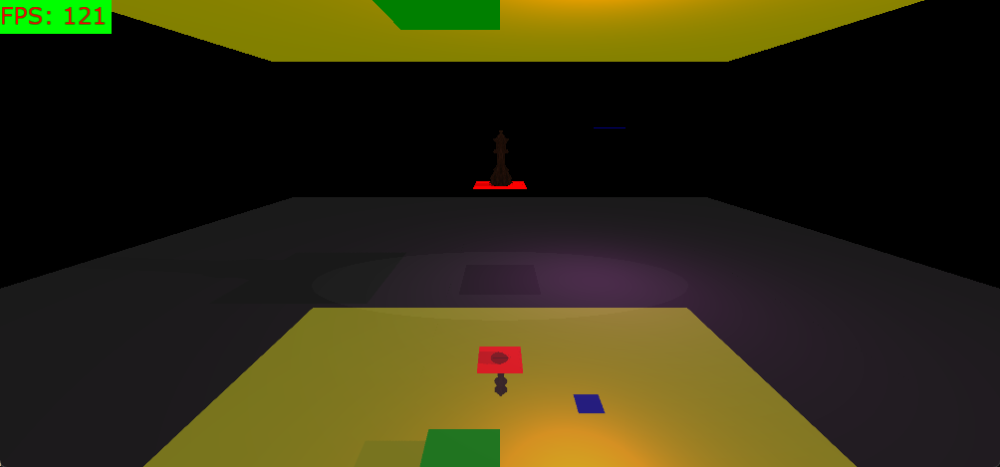

# builder: a hobby C++ game engine



A personal game-engine project I worked on from December 2018 to January 2023 (~490 commits,
~30k lines of hand-written C++20). Most of it was written in 2021–2022.

It is a **research and learning project, not a finished product**. Several subsystems were
rewritten as I learned more, so the repository has two generations of code side by side:

| Generation | Build target | Years | Focus |
|---|---|---|---|
| **Gen 1** | `engine` library, `testgame`, `builder` | 2018–2022 | OpenGL / GLES 3 forward renderer, Windows + Android, constraint-based UI |
| **Gen 2** | `engine_test` | 2022–2023 | Coroutine event system, multithreaded tick scheduler, compile-time shader DSL, new UI with a sparse linear solver and SIMD software compositing |

Gen 2 replaces Gen 1 one piece at a time. Gen 2 has its own platform layer and does not depend
on the Gen 1 renderer.

---

## Gen 2: current architecture (`engine/event`, `engine/ui2`, `engine/graphics`, `engine/platform`, `engine/software`)

### Event system and scripting with C++20 coroutines (`engine/event`)
- **Scripts are coroutines** (`evt::Script`) that `await` conditions:
  ```cpp
  await { ui::stateUpdate() > [](evt::WindowStateUpdate u) { /* ... */ } };
  await { (evt::NextTick(), script->completion > completionEv) };
  ```
- **A compile-time condition compiler** (`CompiledCondition.hpp`). An expression such as
  `atLeast<3>(a) && upperBound<1>(b) || c` is turned in a `constexpr` pass into
  disjunctive normal form. Each AND-clause becomes a bit field in a single `uint64_t`. Every
  event source adds a precomputed mask, and the condition is met when a carry reaches the
  clause's "key bit". At runtime, checking a condition costs one addition and one AND,
  with no allocation and no tree walk.
- Typed event sources and receivers (`ListReceiver`, `KeepLastReceiver`, custom receivers),
  `BinaryState` signals, and piping of events into callbacks with `source > callback`.
- Window lifecycle (`Uninitialized → Invisible → Background → Foreground → Destroyed`) and
  resize, exposed as event sources.

### Tick-based scheduler (`engine/event/Scheduler.cpp`, `Timeline.hpp`, `AsyncTimeline.hpp`)
- Work is grouped into **ticks**. Up to 7 ticks can be in flight at once (stored in a ring
  buffer). A tick closes when its live item count drops to zero, and callbacks posted during it
  are delivered afterwards.
- Each thread has its own LIFO stack and hands surplus work for later ticks to a global
  lock-free queue. Idle threads take work from the oldest active tick first.
- `Timeline` / `AsyncTimeline` run a subsystem (for example the UI instance) on its own
  timeline. Other timelines talk to it with `evt::Ping` and `evt::asyncScript(...)`.
- **Status:** the design is multithreaded, but `EngineImpl` currently starts 0 extra worker
  threads because the lock-free `AtomicQueue` has a known ABA problem.

### CPU job dependency graph (`engine/software/Semaphore.*`)
- `sw::Semaphore` is a counting dependency handle in the style of Vulkan timeline semaphores.
  It supports `fork()`, `merge()`, `thenAsync()` / `thenSync()` and runs callbacks on the
  scheduler once all forks have signalled. Clear, composite, present, atlas update and paint
  are chained with it, so a frame is a small DAG of CPU jobs.

### UI engine with a linear-equation layout (`engine/ui2`)
- **Layout is a sparse linear system.** Every box is 4 variables. Constraints are written in a
  small DSL:
  ```cpp
  box1Eqn = box1.box() == windowRect;
  box3Eqn.right() = box3.contentBox.width() == shift(12_px);
  ```
  The system is solved with a **custom sparse LU decomposition** (`engine/math/sparse`).
  Sizes carry their units (px or pt), so DPI scaling happens when the system is solved.
- **Styles:** style keys are declared at compile time. Small per-widget tables and a shared
  "big" table are combined. Changing a style invalidates only the affected consumers and
  renderers.
- **Rendering:** each renderer draws once into a shared texture atlas. Each frame, the screen is
  split into 16×16 tiles, and every tile records which atlas regions overlap it (up to 3 layers).
- **SWPainter:** an AVX2 compositor that blends atlas layers into the framebuffer, 16 pixels ×
  4 rows at a time, using fixed-point alpha.
- **Canvas:** SIMD (`ui::Register<T>`, 16×u16 lanes) anti-aliased rounded rectangles with 4×
  sub-sample coverage and 8-bit fixed-point colour (`FixedPoint.hpp`).
- **HWPainter:** the same compositing as a compute shader generated by shadergen (see below).
  **In progress:** the shader is defined, but the GPU dispatch is not wired up yet.
- **Status:** works as a demo (`ui2/test.cpp`) with padded, coloured, rounded boxes that react
  to window resizing. There is no text, no input handling and no widget library yet. Variable
  and texture deallocation are unimplemented (`VERIFY_NOT_REACHED`), and the atlas allocator
  only bump-allocates.

### shadergen: GLSL generated from C++ at compile time (`engine/graphics/shadergen`)
- An embedded C++ DSL for shaders that runs **entirely in `constexpr`**. It builds an AST,
  type-checks it, lowers operators, and emits GLSL. The result is stored with `constinit`, so
  no shader text is generated at runtime.
  ```cpp
  AUTO_VARIABLE(prog, color) = imageLoad(screen, screenPos).xyz();
  prog.range(constant(0), data.maxLayers, [&](auto& i) {
      AUTO_VARIABLE(prog, inColor) = imageLoad(atlas, positions[i + constant(1)] + prog.localIndex.xy());
      prog, color = inColor.xyz() * inColor.w + color * (constant(1.0f) - inColor.w);
  });
  ```
- Supports vectors and matrices, `uint`, arrays, casts, user structs (reflected with
  `BEGIN_GEN_STRUCT` / `GEN_FIELD`, std140 layout), uniform and storage buffers, storage images,
  `for`-range loops, and compute-shader built-ins.
- A compressed AST format and an "oversized storage → right-sized `constexpr` array" technique
  move dynamically sized compile-time data into static storage (the same problem my
  C++ proposal P2639 addresses).
- **Status:** compute shaders generate correctly. Vertex/fragment stages for the 3D effect system
  (`render3d/EffectDescriptor.hpp`) were started but are not finished.

### Graphics abstraction (`engine/graphics`)
- `gfx::Instance` / `Frame` / `Allocator` handle frames in flight, staging-buffer bump
  allocation, typed `Buffer<T>` / `Buffer<T[]>` / `Texture<Format>` / `Shader<Interface>`
  handles, and software image handles for the CPU path.
- **Status:** early. Upload to the GPU is a placeholder, and the software path is the only one
  that renders.

### Platform layer (`engine/platform`)
- Win32 window backend with the window lifecycle as events, a WGL/GL core loader, a thread-local
  storage scheme with fixed TLS slots, and readable names for all Win32 error codes.
- **Status:** Windows only. Android has not been ported to Gen 2.

---

## Gen 1: the original engine (`engine/GL`, `engine/3d`, `engine/ui`, `engine/windows`, `engine/android`)

### Renderer (OpenGL 3.3+ / OpenGL ES 3)
- Thin GL wrappers: shaders, textures (including depth textures), cube maps, framebuffers,
  std140 uniform helpers, and a GPU memory allocator (`GAllocator`).
- **Composable effect system:** each effect (`AmbientLight`, `UniformColor`, `TextureColor`,
  `SpotLight`, `PointLight`, `Reflection`, …) adds GLSL snippets, uniforms, attributes and
  varyings to a shader builder. Shader permutations are generated and cached for each
  combination of effects.
- **Shadows:** spot-light shadow maps and omnidirectional point-light shadows with depth cube maps
  (6 depth passes).
- `Renderpass` / `Shaderpass` group objects per pass. On-screen debug views show depth maps and
  cube maps.
- **`render3d` scene graph** (2022): transform, world-transform, bounding-sphere, object and
  **portal** nodes. Portal nodes build view-space cull planes from portal polygons. The render
  tree's subsequences are swapped lock-free with CAS.
- **Status:** `testgame` renders a lit, textured chess-piece scene with a spot light and a moving
  point light, both with shadows, plus reflections and a free-look camera. Gen 1 was never
  optimised or tested beyond that scene.

### Platforms
- **Windows:** Win32 + WGL, DirectWrite/Direct2D text rasterisation, fullscreen handling.
- **Android (NDK):** native activity loop with `ALooper`, `AChoreographer` frame pacing, EGL,
  touch and key input, assets read through `AAssetManager`, and text rasterised in Java through
  JNI. **The APK is built by CMake alone** (`android_app.cmake`: javac → dx → aapt → zipalign →
  apksigner, without Gradle).
- **Vulkan:** only instance, physical-device and VMA initialisation (`engine/VK`). It never
  rendered.

### UI (Gen 1)
- Constraint layout with a fluent API (`scene.layout(c).alignTop().alignLeft().wrapContentHeight()`),
  typed sizes (px / DIP / mm), text components and simple input. It is used by the `builder` app,
  a small file explorer.

### Resources
- Wavefront OBJ/MTL parser, JPEG decoding through libjpeg-turbo, and platform asset streams.

---

## Shared libraries (`engine/containers`, `engine/memory`, `engine/math`, `engine/util`)

- **Containers:** `StableVector`, `IdAllocator`, `FlatSet`, `BitSet`, `SmallPoolAllocator`,
  `RangeAllocator`, `AtomicBumpAllocator`, `AtomicQueue`, `AtomicArrayBuilder`, `CacheMap`
  with x86 SIMD and portable/ARM tag-matching back ends, `DirectedAcyclicGraph`, BFS/DFS,
  `EnumTable`, `FixedString`, `Tuple`, `Owned<T>`.
- **Math:** `Vec2/3/4`, `Mat3x3/4x4` (frustum, look-at, inverse), rectangles and boxes, convex
  polygons. Sparse vectors and matrices, LU decomposition, sparse inverse, and an incremental
  **linear-programming solver** (KKT-based) that was used for the Gen 1 UI and an experiment in
  shader-binding allocation.
- **Utilities:** a tagged logger with compile-time-switchable `VERIFY` / `EXPECT` per subsystem,
  `stx::BasicCallback` (a small-buffer, non-allocating callable), coroutine helpers, and
  `constexpr` reflection helpers.

---

## Building

Requirements: CMake ≥ 3.18, **clang** with C++20 support (tested with clang 19.1.7 from the
winlibs MinGW-w64 distribution), an x86-64 CPU with AVX2/BMI/FMA, and the git submodules
(`fmt`, `libjpeg-turbo`, `Vulkan-Headers`).

```bash
git submodule update --init
cmake -S . -B build -G Ninja -DCMAKE_CXX_COMPILER=clang++ -DCMAKE_C_COMPILER=clang -DCMAKE_POLICY_VERSION_MINIMUM=3.5
cmake --build build --target engine_test   # Gen 2 UI / event demo
cmake --build build --target testgame      # Gen 1 3D demo
```

`-DCMAKE_POLICY_VERSION_MINIMUM=3.5` is only needed with CMake 4.x, because the pinned
`libjpeg-turbo` submodule declares an older minimum version.

> **Compiler note:** GCC is currently not supported. shadergen builds its AST in `constexpr`
> storage, and GCC 16.2 rejects that valid code. A minimal reproduction is below: GCC accepts the
> definition and then reports the value as "used in its own initializer".
> ```cpp
> struct In { const int* p = nullptr; constexpr In() { int local = 0; p = &local; p = nullptr; } };
> constexpr In x {};
> static_assert(x.p == nullptr); // error with GCC 16.2, fine with clang
> ```
> MinGW GCC also cannot keep 32-byte AVX stack slots aligned on Windows (GCC bug 54412). Code
> built with `-mavx2` can therefore crash on aligned AVX stores.

For Android, configure with the NDK toolchain file. `android_setup.cmake` and
`android_app.cmake` locate the SDK build tools and package `testgame` as an APK.
